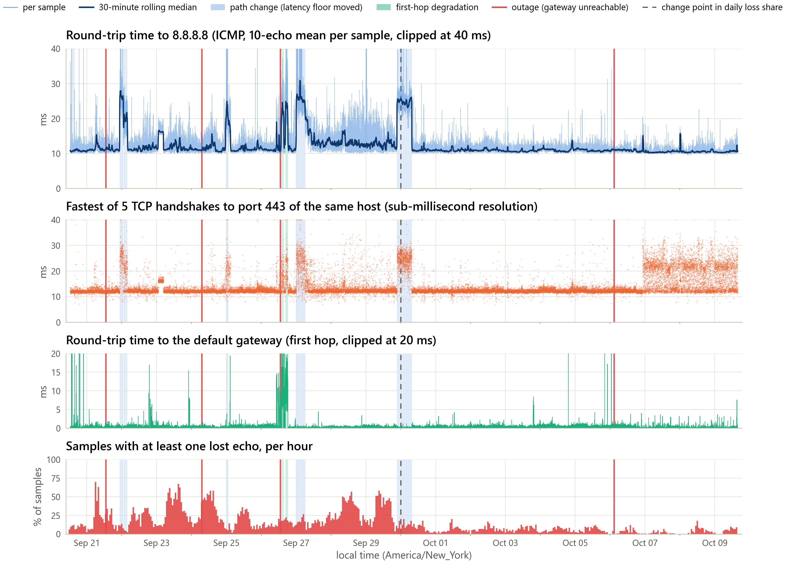
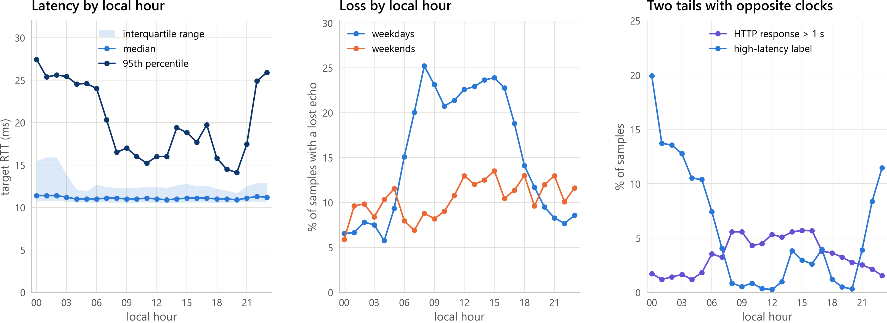
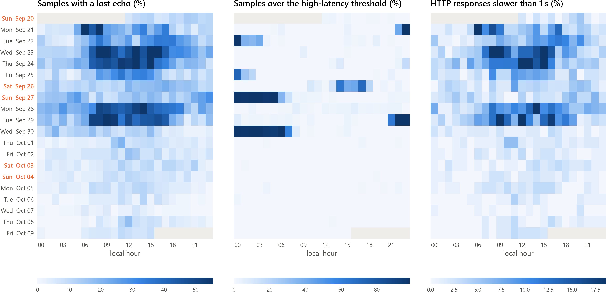
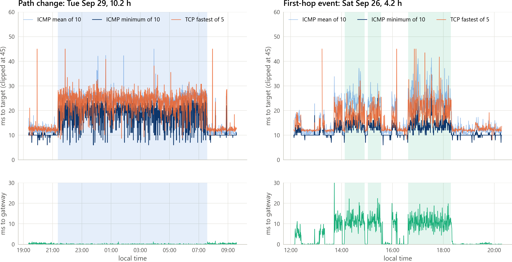
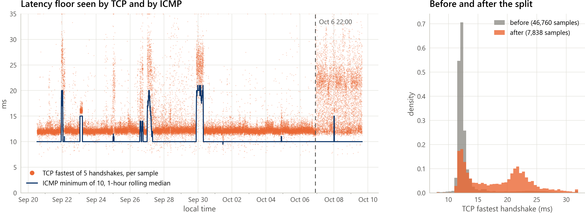
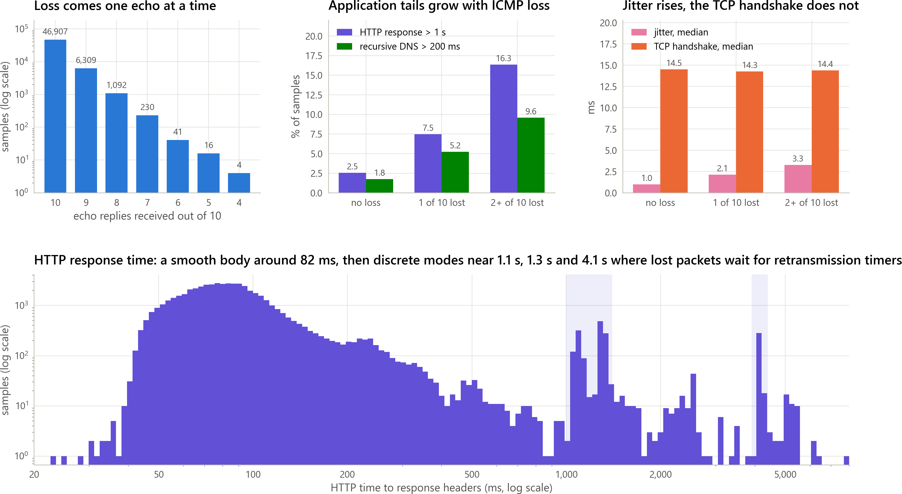
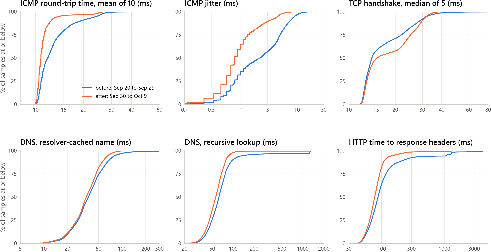
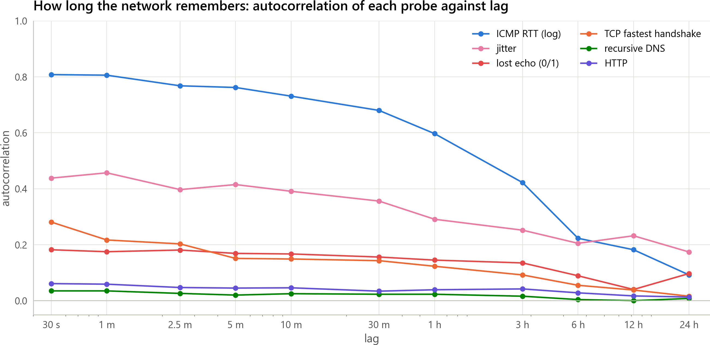
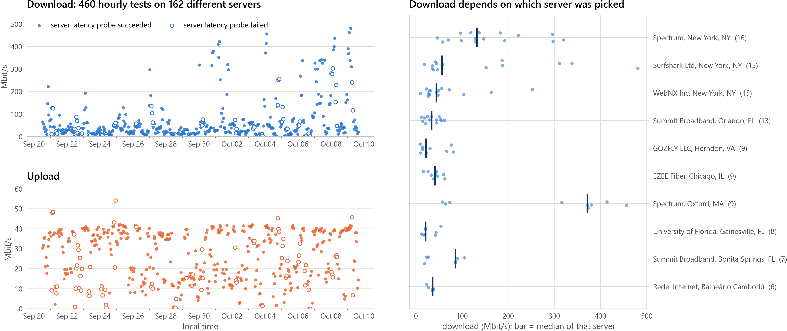
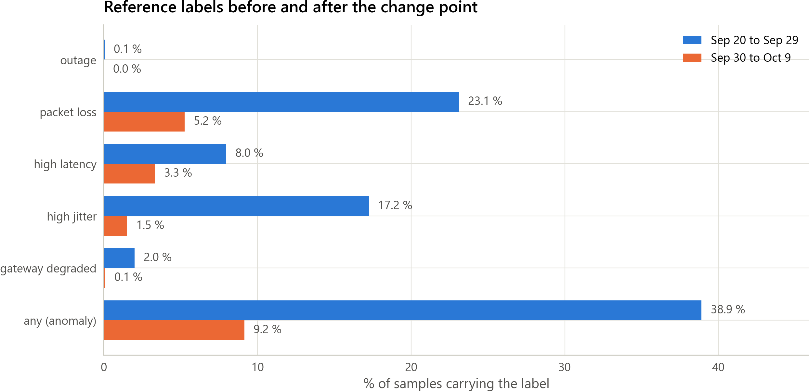

# LocalNet-Dynamics

A longitudinal telemetry dataset of a real residential network, and the
toolkit that produces it.

One wired desktop sampled its network every 30 seconds, around the clock, for
19 days (2026-09-20 to 2026-10-09, US Eastern time): ICMP latency, jitter and
loss to a reference host and to the local gateway, TCP connect time, DNS
response time for a resolver-cached and for a never-seen name, HTTP
time-to-first-response, and an hourly WAN speed test. The result is 54,617
samples at 99.1 % coverage, consolidated into one table with time-of-day
features, rule-based reference labels and a documented build pipeline.

| | |
|---|---|
| Author | Alexander Ezharjan |
| Dataset card | [DATASET_CARD.md](DATASET_CARD.md) (schema, protocol, statistics, limitations) |
| Hugging Face | [huggingface.co/datasets/ezharjan/LocalNetDynamics](https://huggingface.co/datasets/ezharjan/LocalNetDynamics) |
| DOI | [10.57967/hf/10841](https://doi.org/10.57967/hf/10841) |
| Source code | [github.com/Ezharjan/LocalNetDynamicsDataset](https://github.com/Ezharjan/LocalNetDynamicsDataset) |
| License | MIT (code and data) |

## What the data shows

Every number below is computed by `scripts/analyze.py` and stored in
[`dataset/analysis.json`](dataset/analysis.json); every figure is rendered by
`scripts/plot_figures.py` as PNG and PDF under `figures/`.

### The whole capture at a glance



The 19 days split into two very different halves. A single change point in
the daily share of samples with ICMP loss falls on 2026-09-30: before it,
23.2 % of samples lost at least one of their ten echoes, the 95th percentile
of the round-trip time was 24.3 ms and 38.9 % of samples carried an anomaly
label; from September 30 on, those figures are 5.3 %, 14.2 ms and 9.2 %. The
four outages (red lines) each lasted 2 to 2.5 minutes and took the gateway down
with the target, so all of them were first-hop events, not ISP events. The
shaded bands are the long high-latency episodes, classified below.

### Loss has a business-hours clock, the latency tail has a night-time one



On weekdays the share of samples with a lost echo climbs from about 6 % at
night to 25 % at 08:00 and stays above 20 % until 16:00; on weekends it never
shows that peak. The latency tail runs the other way: the 95th percentile of
the round-trip time sits between 14 and 20 ms from 08:00 to 21:00 and between
24 and 27 ms from 22:00 to 06:00, because the six path-change episodes
described below all fall between 21:21 and 07:34.



Day by hour, the daytime loss is a weekday phenomenon of the first ten days,
the overnight latency plateaus are four distinct nights, and the slow HTTP
responses track the loss, not the latency.

### Two anatomies of degradation



Nine high-latency episodes last 30 minutes or more and contain 88.4 % of all
high-latency labels. Six of them are path changes: the latency *floor* moved.
The fastest of five TCP handshakes rises from its 12.3 ms baseline to between
19.5 and 25.7 ms in all six, and in the three longest the minimum ICMP time
rises with it from 10 to 17-20 ms; the gateway stays at 0 ms and the DNS
probe, whose queries the gateway forwards to the upstream resolver, barely
moves (36 to 40 ms against a 35 to 37 ms baseline), which places the extra 7
to 13 ms on the route towards 8.8.8.8, beyond the first hop and beyond the
point where the resolver path branches off. The longest one ran from 21:21 on September
29 to 07:34 the next morning. The other three episodes, all on the afternoon of
Saturday September 26, are a first-hop event: the gateway itself answered in
10 to 11 ms instead of 0.2 ms, from 14:07 to 18:17 with shorter bursts from
10:19 on, and every other probe inherited the delay. That day holds 507 of the
560 gateway-degraded labels.

### What ping cannot see



From 22:00 on October 6 the fastest of five TCP handshakes to port 443 of
8.8.8.8 became bimodal, 12.9 ms at the first quartile and 22.2 ms at the
third, while ICMP echoes to the same address kept their 10 ms floor. The share
of samples in which TCP sits more than 5 ms above ICMP went from 7.2 % to
63.7 %. A split of that kind, which is what per-flow load balancing produces,
is invisible to a pure ping monitor; the dataset carries both probes so that
it is not invisible here.

### What a lost echo means



Loss arrives one echo at a time: 6,309 samples lost exactly one of ten, 1,092
lost two, 230 lost three. In samples with one lost echo the median jitter
doubles (1.0 to 2.1 ms), HTTP responses slower than one second become three
times as frequent (2.5 % to 7.5 %) and recursive DNS lookups slower than
200 ms likewise (1.8 % to 5.2 %), while the median TCP handshake does not move
(14.5 to 14.3 ms). The HTTP distribution is not a smooth tail: beyond its
82 ms body it has discrete modes near 1.1 s, 1.3 s and 4.1 s, whose timing
matches the retransmission timers of the operating system's resolver and TCP
stack waiting out a lost packet.

### Before and after the change point



The empirical distribution of every probe for September 20 to 29 against
September 30 to October 9. Latency, jitter and HTTP tighten markedly; the TCP
handshake is the one probe whose later distribution gains a second mode, from
the October 6 split.

### How long the network remembers



The log round-trip time has a lag-1 autocorrelation of 0.81, still 0.68 after
30 minutes and 0.42 after three hours, but only 0.09 at a one-day lag: this
site has persistence, not a daily cycle. Jitter keeps 0.17 of its correlation
at a one-day lag. The loss indicator is weakly persistent (0.18 at
lag 1; a sample following a lossy sample is lossy with probability 0.30 against
a base rate of 0.14). DNS and HTTP timings are memoryless at every lag.

### WAN throughput is a server lottery



The 460 hourly speed tests ran through the `speedtest-cli` fallback with no
pinned server and landed on 162 different servers; 79 of them could not even
measure the server's latency, and seven reported a download of 0 Mbit/s. Among the ten most
used servers the median download ranges from 21 to 372 Mbit/s, so the download
column says more about the server than about the access link. Upload is far more stable: median
28.6 Mbit/s, 90th percentile 40.3 Mbit/s. Treat the throughput columns as a
lower bound and read the dataset card before using them.

### Reference labels



23.9 % of samples carry at least one label; 10,205 carry exactly one and 2,831
two or more. The high-jitter label is the one that changes most between the
two halves (17.2 % to 1.5 %).

## What is measured

Every sample is one row. All latency values are in milliseconds.

| Group | Columns | How it is measured |
|---|---|---|
| Target latency | `rtt_min_ms`, `rtt_avg_ms`, `rtt_median_ms`, `rtt_max_ms`, `rtt_stddev_ms`, `jitter_ms`, `packets_sent`, `packets_received`, `packet_loss_pct` | 10 ICMP echo requests to `--target` (default `8.8.8.8`), sent one second apart; parsed from the operating system's `ping` |
| Gateway latency | `gateway_rtt_min_ms`, `gateway_rtt_avg_ms`, `gateway_rtt_max_ms`, `gateway_jitter_ms`, `gateway_packet_loss_pct` | 5 ICMP echo requests to the default gateway, concurrently with the target probe; separates LAN/Wi-Fi problems from ISP problems |
| TCP connect | `tcp_connect_min_ms`, `tcp_connect_median_ms` | 5 TCP handshakes to `target:443`; sub-millisecond resolution on every platform and not subject to ICMP de-prioritisation |
| DNS | `dns_resolve_ms`, `dns_recursive_ms`, `dns_server` | Raw UDP queries to the system resolver: a fixed name (served from the resolver cache after the first sample) and a random, never-seen subdomain (forces a full recursive lookup). The operating-system cache is bypassed |
| HTTP | `http_ms`, `http_status` | Time to the response headers of a small connectivity-check URL, system proxy bypassed |
| Wi-Fi link | `wifi_signal_pct`, `wifi_rssi_dbm`, `wifi_rx_mbps`, `wifi_tx_mbps`, `wifi_channel`, `wifi_band_ghz`, `wifi_phy`, `wifi_ssid` (opt-in) | `netsh wlan` (Windows), `iw` (Linux), `system_profiler` (macOS); empty on wired links |
| WAN throughput | `download_mbps`, `upload_mbps`, `speedtest_ping_ms`, `download_loaded_latency_ms`, `upload_loaded_latency_ms`, `speedtest_server_id`, `speedtest_server` | Ookla Speedtest on its own cadence (default every 30 min), run after the latency probes of the sample so it cannot bias them. Loaded latency (latency during the transfer, a bufferbloat indicator) is available with the official Ookla CLI |
| LAN throughput | `lan_throughput_mbps`, `lan_retransmits` | `iperf3` against a server on the LAN, own cadence |
| Context | `run_id`, `host_label`, `sample_index`, `timestamp_utc`, `timestamp_local`, `epoch_s`, `elapsed_s`, `link_type`, `gateway_ip`, `target`, `sample_duration_s`, `notes` | Identity, time (UTC and local with offset), wired/wireless link type, probe errors |

The builder adds run context, time features, gap information, six reference
labels and manual event annotations; the dataset card lists every column.

## Repository layout

```text
LocalNetDynamicsDataset/
├── README.md                 this file
├── DATASET_CARD.md           dataset card: schema, label rules, protocol, findings, statistics
├── HUGGINGFACE_UPLOAD.md     step-by-step guide for publishing the huggingface/ folder
├── CITATION.cff              citation metadata for the source code
├── LICENSE                   MIT
├── requirements.txt          Python dependencies for building, analysing and testing
├── scripts/
│   ├── collect_data.py       collector (standard library only)
│   ├── build_dataset.py      merges raw runs, adds features, labels and events, refreshes the card
│   ├── annotate.py           records manual event annotations
│   ├── analyze.py            statistics, episodes and findings -> dataset/analysis.json
│   ├── plot_figures.py       figures -> figures/png and figures/pdf
│   └── package_huggingface.py assembles the huggingface/ folder from the files above
├── tests/                    pytest suite (parsers for every supported platform, build, analysis, figures)
├── dataset/
│   ├── raw/                  one CSV + JSON per collection run, exactly as written by the collector
│   ├── localnet_dynamics.csv     consolidated dataset (built)
│   ├── localnet_dynamics.parquet consolidated dataset, same content (built)
│   ├── summary.json              statistics and per-run label thresholds (built)
│   └── analysis.json             findings quoted in the documentation (built)
├── figures/
│   ├── png/                  figures at 200 dpi
│   └── pdf/                  the same figures as vector PDF
└── huggingface/              self-contained copy for Hugging Face (generated, not tracked by git)
```

## Requirements

- Python 3.8 or newer. The collector uses only the standard library and the
  operating system's `ping`.
- Optional, for WAN throughput: the [Ookla Speedtest CLI](https://www.speedtest.net/apps/cli)
  (`speedtest` on the PATH, preferred; provides loaded latency) or
  `pip install speedtest-cli` (fallback, see the limitations in the card).
- Optional, for LAN throughput: `iperf3` on the collector and `iperf3 -s` on
  another LAN host.
- For building, analysing, plotting and testing: `pip install -r requirements.txt`
  (pandas, numpy, pyarrow, matplotlib, pytest).

## Quick start

Check the environment first. This detects the gateway, link type and resolver,
takes one sample and prints it as JSON without writing any files:

```bash
python scripts/collect_data.py --check
```

Start a collection run. The example below samples every 30 seconds for 30 days,
runs a WAN speed test every hour, and labels the vantage point:

```bash
python scripts/collect_data.py --duration 30d --interval 30s --speedtest --speedtest-every 1h --host-label desktop-eth
```

Every completed sample is written to `dataset/raw/localnet_<run_id>.csv`
immediately; a run can be stopped at any time with Ctrl-C and the files remain
valid. The run metadata (`dataset/raw/localnet_<run_id>.json`) is refreshed every
five minutes and finalised when the run ends.

When enough data has been collected, build the consolidated dataset, run the
analysis, render the figures and assemble the Hugging Face folder:

```bash
python scripts/build_dataset.py
python scripts/analyze.py
python scripts/plot_figures.py
python scripts/package_huggingface.py
```

## Collection protocol

The value of the dataset comes from uninterrupted, regularly spaced samples
over many diurnal cycles. The published run follows the protocol below, which
is also the recommended setup for new vantage points.

- Interval 30 s (2,880 samples per day, 86,400 per 30 days). The latency
  probes take about 10 s per sample; anything below 15 s is not recommended.
- Duration of at least 14 days; 30 days or more captures weekday/weekend
  effects with enough repetitions.
- The collector inhibits system sleep while running (Windows
  `SetThreadExecutionState`, macOS `caffeinate`, Linux `systemd-inhibit`). It
  cannot prevent sleep on lid close: on a laptop set the lid-close action to
  "do nothing" and keep the machine on mains power.
- Keep the machine in one place for the whole run, or record moves with
  `annotate.py` (`--category environment`). The default gateway and link type
  are re-detected every 15 minutes, so a change of network is visible in the
  `gateway_ip` and `link_type` columns.
- Record notable household events (streaming, large downloads, video calls,
  router reboots, ISP maintenance) as they happen with `annotate.py`. They
  become the `event_category` and `event_description` columns.
- Pin the speed-test server (`--speedtest-server <id>`, see
  `speedtest --servers` or `speedtest-cli --list`) and prefer the official
  Ookla CLI. The published run did neither, and its throughput columns show
  the cost: see the findings above.
- For a paired wired/wireless view, run a second collector on another machine
  on the same network with a different `--host-label`; the builder keeps runs
  apart by `run_id` and computes label thresholds per run.
- Leave the network in normal use. The dataset is meant to reflect real
  household traffic, not a quiet lab.

## Command-line reference

`python scripts/collect_data.py [options]`

| Option | Default | Description |
|---|---|---|
| `--duration` | `24h` | total run time (`6h`, `7d`, `30d`) |
| `--interval` | `30s` | time between sample starts |
| `--target` | `8.8.8.8` | reference host for the ICMP and TCP probes |
| `--ping-count` | `10` | ICMP echo requests per sample, sent 1 s apart |
| `--gateway-ping-count` | `5` | ICMP echo requests to the default gateway per sample |
| `--ping-timeout` | `2.0` | seconds to wait for each ICMP reply / TCP connect |
| `--tcp-port` | `443` | TCP port on the target for connect-time probes (`0` disables) |
| `--tcp-count` | `5` | TCP connections per sample |
| `--dns-host` | `example.com` | name for the DNS probes; the recursive probe queries a random subdomain of it |
| `--dns-server` | auto | resolver IP to query (default: the resolver of the default-route interface, then the gateway) |
| `--dns-timeout` | `3.0` | DNS query timeout in seconds |
| `--http-url` | `http://www.msftconnecttest.com/connecttest.txt` | URL for the HTTP probe (`''` disables) |
| `--http-timeout` | `5.0` | HTTP probe timeout in seconds |
| `--no-wifi` | | do not query Wi-Fi link metrics |
| `--record-ssid` | off | store the Wi-Fi network name (identifies the site; off by default) |
| `--speedtest` | off | run WAN speed tests |
| `--speedtest-every` | `30m` | interval between WAN speed tests |
| `--speedtest-server` | none | Ookla server id to pin |
| `--iperf-server` | none | address of an `iperf3 -s` host on the LAN |
| `--iperf-port` | `5201` | iperf3 port |
| `--iperf-every` | `30m` | interval between LAN throughput tests |
| `--iperf-duration` | `10` | seconds per iperf3 test |
| `--iperf-reverse` | off | measure server-to-client instead of client-to-server |
| `--output-dir` | `dataset/raw` | directory for the run files |
| `--run-id` | `<label_>YYYYMMDD_HHMMSS` | run identifier and file stem |
| `--host-label` | empty | label of the vantage point, stored in every row |
| `--no-keep-awake` | | do not inhibit system sleep |
| `--quiet` | | print only the final summary |
| `--check` | | detect the environment, take one sample, print JSON, exit |

Scheduling: samples start at fixed ticks (`start + k * interval`). If a sample
overruns the interval (a speed test, or an outage in which every probe waits
for its timeout) the collector skips to the next tick rather than drifting,
and the missing ticks show up as a larger `gap_before_s` in the built dataset.
Every ICMP echo waits at most `--ping-timeout`, so the worst case for the
default settings is about 20 s per sample.

## Output files

`dataset/raw/localnet_<run_id>.csv` has one row per sample with the columns
listed in the dataset card (empty cell = not measured / failed; the `notes`
column says why). `dataset/raw/localnet_<run_id>.json` holds the run
configuration, the environment (OS, Python version, time zone, ping
resolution), the detected network (gateway, interface, link type, resolver) and
running summary statistics.

`scripts/build_dataset.py` merges all runs into `dataset/localnet_dynamics.csv`
and `.parquet`, adds:

- run context: `collector_version`, `collector_os`, `interval_s`, `rtt_resolution_ms`;
- time features from the local timestamp: `date_local`, `hour_local`,
  `weekday_local` (0 = Monday), `is_weekend`, and `gap_before_s`;
- reference labels computed with documented rules: `label_outage`,
  `label_packet_loss`, `label_high_latency`, `label_high_jitter`,
  `label_gateway_degraded`, `label_anomaly`;
- manual annotations: `event_category`, `event_description`;

sets the speed-test latency to missing where the `speedtest-cli` fallback
recorded a failed probe (a value of 600,000 ms or more), writes
`dataset/summary.json` (row counts, coverage, per-metric statistics, per-run
label thresholds) and refreshes the statistics section of `DATASET_CARD.md`.
The label rules are specified in the dataset card.

`scripts/analyze.py` writes `dataset/analysis.json`: overall statistics,
hour-of-day and day-by-day profiles, the change point between the two regimes,
outage and high-latency episodes with their diagnosis, the conditional effect
of ICMP loss on the other probes, the TCP/ICMP split, DNS and HTTP facts,
autocorrelation, speed-test quality and label statistics. It also prints a
text report. `scripts/plot_figures.py` renders the ten figures from the same
numbers, each as a 200 dpi PNG and as a vector PDF cropped to the drawn area.

## Annotating events

```bash
python scripts/annotate.py "4K streaming on the living-room TV" --category load --minutes 45
python scripts/annotate.py "router rebooted" --category maintenance
python scripts/annotate.py "laptop moved to the garden" --category environment --start "2026-09-12 16:00" --end "2026-09-12 18:30"
python scripts/annotate.py --list
```

Categories: `load`, `outage`, `maintenance`, `environment`, `isp`, `device`,
`other`. Times without an offset are interpreted as local time; the file
`dataset/raw/events.csv` stores UTC. No events were recorded during the
published run.

## Loading the dataset

```python
import pandas as pd

df = pd.read_parquet("dataset/localnet_dynamics.parquet")
evening = df[df.hour_local.between(19, 22)]
print(evening.rtt_avg_ms.describe())
print(df.groupby("hour_local").packet_loss_pct.apply(lambda s: (s > 0).mean()))
```

From the Hugging Face Hub:

```python
from datasets import load_dataset

ds = load_dataset("ezharjan/LocalNetDynamics", split="train")
```

## Tests

```bash
pip install -r requirements.txt
python -m pytest tests
```

The suite covers the `ping` parsers with sample output from Windows
(English, Chinese, German, French, Russian, IPv6), Linux (iputils and BusyBox)
and macOS, the route/resolver/interface parsers for the three platforms, the
Wi-Fi parsers, DNS packet construction, speed-test and iperf3 output, the
handling of failed speed-test latency probes, and the complete build, analysis
and figure pipeline on a synthetic run generated inside the test.

## Platform notes

- Windows: `ping` reports whole milliseconds and prints `<1ms` for
  sub-millisecond replies, which are stored as 0. The TCP connect columns
  provide sub-millisecond latency on every platform. The gateway, interface
  type and resolver are read with PowerShell (`Get-NetRoute`,
  `Get-NetAdapter`, `Get-DnsClientServerAddress`), which works in every
  display language; `route print` is the fallback and does not report the
  media type, which is why the published run has `link_type = unknown`.
- Linux: `iw` is used for Wi-Fi metrics when present, `/proc/net/wireless`
  otherwise; `resolvectl` is consulted when `/etc/resolv.conf` points to the
  local stub resolver.
- macOS: `system_profiler SPAirPortDataType` provides the Wi-Fi metrics and
  takes a few seconds per call; it runs in parallel with the latency probes.
- IPv6 targets work for the ICMP and TCP probes; gateway detection is IPv4.

## Citation

If you use the source code (the collector, the build pipeline or the
analysis), cite the software:

```bibtex
@software{ezharjan_localnetdynamics_code_2026,
  author  = {Ezharjan, Alexander},
  title   = {LocalNet-Dynamics: collector, build pipeline and analysis toolkit for longitudinal home-network telemetry},
  year    = {2026},
  version = {1.0.0},
  url     = {https://github.com/Ezharjan/LocalNetDynamicsDataset}
}
```

If you use the data, cite the dataset:

```bibtex
@dataset{ezharjan_localnetdynamics_data_2026,
  author    = {Ezharjan, Alexander},
  title     = {LocalNet-Dynamics: A Longitudinal Local Area Network Telemetry Dataset},
  year      = {2026},
  version   = {1.0.0},
  publisher = {Hugging Face},
  doi       = {10.57967/hf/10841},
  url       = {https://huggingface.co/datasets/ezharjan/LocalNetDynamics}
}
```

[CITATION.cff](CITATION.cff) holds the machine-readable form of the software
citation; the dataset's own `CITATION.cff` ships inside the Hugging Face
repository.

## License

MIT, see [LICENSE](LICENSE).
